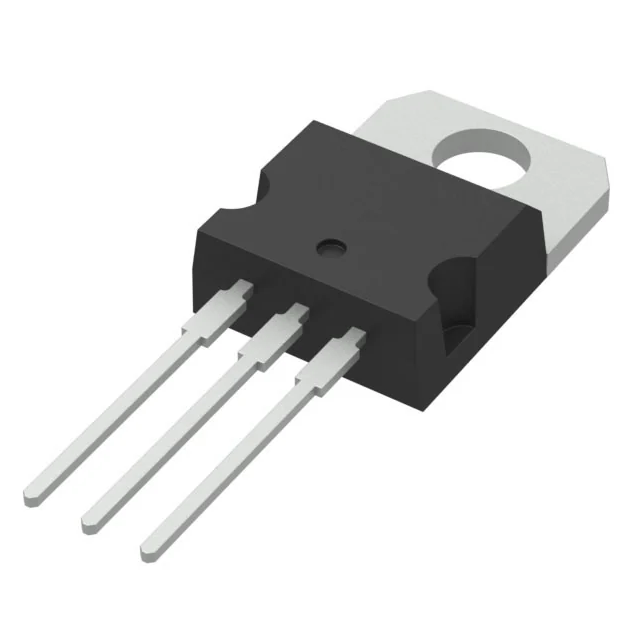
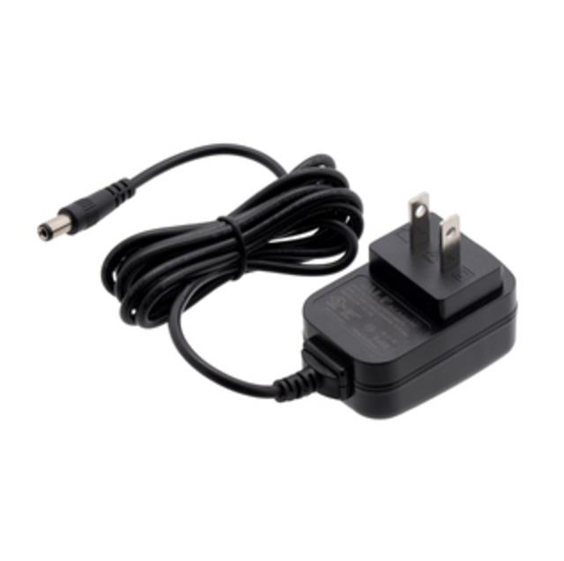
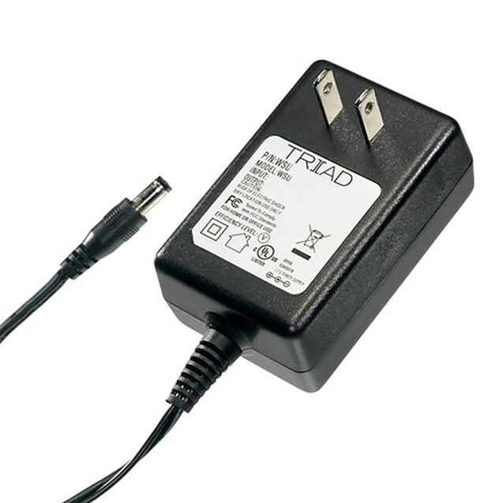
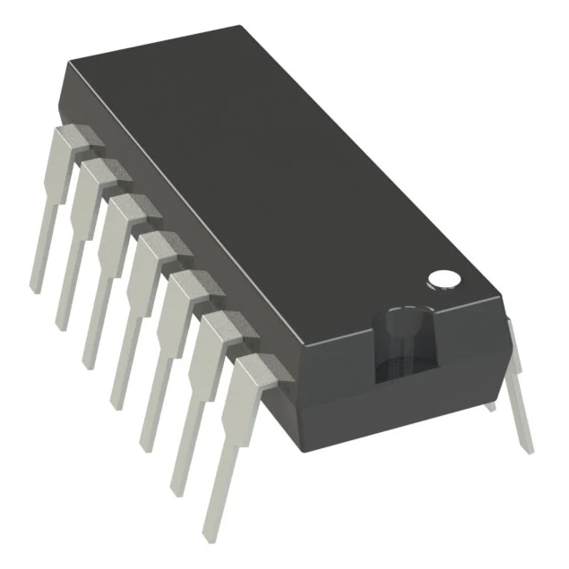
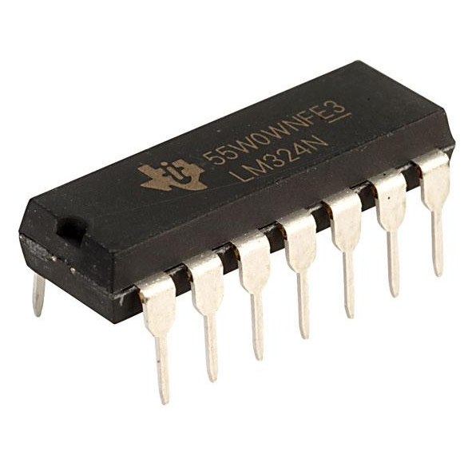
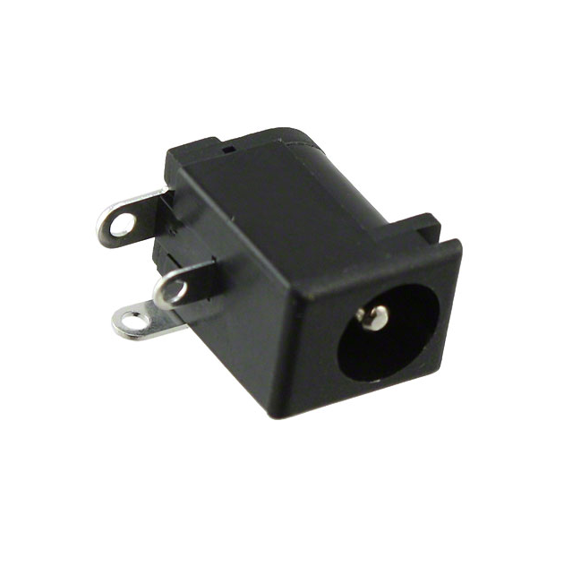

**Voltage Regulator**

1. Texas Instruments UA7805CKCS Voltage Regulator 

    

    * $1.63/each
    * [link to product](https://www.st.com/content/ccc/resource/technical/document/datasheet/41/4f/b3/b0/12/d4/47/88/CD00000444.pdf/files/CD00000444.pdf/jcr:content/translations/en.CD00000444.pdf)

    | Pros                                      | Cons                                                             |
    | ----------------------------------------- | ---------------------------------------------------------------- |
    | Established 7805 style regulator design | Linear regulator heat losses still apply |
    | Fixed 5 V output requires no output voltage adjustment | Availability seems scarce |
    | Through hole versions are suitable for prototyping | May cost more than other compatible options |

1. STMicroelectronics L7805BV Voltage Regulator 

    

    * $1.53/each
    * [Link to product](https://www.digikey.com/en/products/detail/stmicroelectronics/L7805ABV-DG/3945936)

    | Pros                                                     | Cons                |
    | ---------------------------------------------------------| ------------------- |
    | Provides fixed 5 V suitable for Curiosity Nano and MCP6004 | Needs an input voltage above 5 V, with sufficient headroom.|
    | Through-hole TO-220 package is relatively easy to solder | Excess input voltage is dissipated as heat. |
    | Includes overtemperature and short-circuit protection    | The 1.5 A rating does not guarantee that it can deliver 1.5 A continuously without appropriate thermal management. |

1. NTE960 Voltage Regulator 

    

    * $1.50/each
    * [Link to product](https://vetco.net/products/nte960_5_volt_1a_voltage_regulator_3-pin_to220_-_nte960?utm_source)

    | Pros                                                     | Cons                |
    | ---------------------------------------------------------| ------------------- |
    | Fixed 5 V output         | May not deliver consistent 1 A according to reviews|
    | Through-hole package is convenient for assembly | Releases more heat than other similar components |
    |  Its 1 A output rating may be sufficient for a modest logic board | Better choices for a similar price |
**Choice:** Option 2: STMicroelectronics L7805BV Voltage Regulator

**Rationale:** The L7805BV was selected for its fixed 5 V output. Its simple design makes it easy to integrate into the PCB. Its through-hole package also makes assembly easier, and I already own the component. 

**External Power Supply**

1. WALL ADAPTER 9VDC 1A, 5.5X2.1MM External Power Supply

    

    * $11.41/each
    * [link to product](https://www.digikey.com/en/products/detail/pololu/1470/19200211)

    | Pros                                      | Cons                                                             |
    | ----------------------------------------- | ---------------------------------------------------------------- |
    | Supplies up to 1 A at 9 V | A linear 5 V regulator will dissipate substantial heat dropping 9 V to 5 V |
    | Convenient for a stationary prototype | The adapter's connector might not fit perfectly with the preferred jack; it might work with a backup. |
    | Provides more input voltage than a 5 V rail requires | Its current capacity must be checked against the calculated system load |

1. Avue 12V, 1 A Adapter External Power Supply

    

    * $9.99/each
    * [Link to product](https://www.microcenter.com/product/449788/avue-dc12v-1a-power-adapter?utm_source)

    | Pros                                                     | Cons                |
    | ---------------------------------------------------------| ------------------- |
    | A readily purchasable wall adapter. | Same linear regulator heat concern as option 1. |
    | Rated for 12 W of output power. | The connector and polarity must be verified. |
    | Suitable for evaluating a stationary prototype if the connector and electrical specifications match.| Must have sufficient current remaining after accounting for all loads. |

1. Triad Magnetics AC/DC WALL MOUNT ADAPTER 9V 12W External Power Supply 

    

    * $7.99/each
    * [Link to product](https://www.digikey.com/en/products/detail/triad-magnetics/WSU090-1300-R/3094978)

    | Pros                                                     | Cons                |
    | ---------------------------------------------------------| ------------------- |
    | Supplies 9 V DC and is intended for continuous equipment power. | The jack's inner diameter is 2.0 mm, while the adapter plug is listed as 2.1 mm. |
    | Lower input voltage than 12 V reduces the regulator's voltage drop and heat. | Its center-negative connector may not match the barrel jack. |
    | Listed output current is 1.3 A. | A linear regulator will still dissipate heat, and actual current demand must be calculated. |
   
**Choice:** Option 1:  WALL ADAPTER 9VDC 1A, 5.5X2.1MM External Power Supply 

**Rationale:** The 9 V adapter was selected because it provides a practical power source for a stationary prototype. It produces less heat than a 12 V adapter with a linear regulator. It can provide consistent power without requiring a battery. Its polarity and connector match one of the two potential jacks. 

**Op Amp**

1. Microchip Technology MCP6004-I/P Op Amp

    

    * $0.60/each
    * [link to product](https://www.digikey.com/en/products/detail/microchip-technology/MCP6004-I-P/523060?gclsrc=aw.ds&gad_source=1&gad_campaignid=20790518593&gbraid=0AAAAADrbLliJItBqguLw7XKry3y1w794w&gclid=CjwKCAjwl4HXBhAjEiwAHlpWhFUJ2dQqAaFPD_3AsAtwFl_I4R_VA-0ROPuMHdSRvImSbvAWkVXC_hoCsxIQAvD_BwE)

    | Pros                                      | Cons                                                             |
    | ----------------------------------------- | ---------------------------------------------------------------- |
    | Low power consumption: Typical supply current is about 100 µA. | Its switching behavior may be less predictable than a comparator designed for threshold detection. |
    | Already in Possession| Its 1 MHz gain bandwidth makes it unsuitable for some high-speed applications. |
    | Rail-to-rail input-to-output | Can be easily damaged |

1. Texas Instruments LM324N Op amp

    

    * $0.58/each
    * [Link to product](https://www.digikey.com/en/products/detail/texas-instruments/LM324N/277627)

    | Pros                                                     | Cons                |
    | ---------------------------------------------------------| ------------------- |
    | Works with 5V supply | Output does not reach the positive supply rail. |
    | Easy to socket and replace | 	Higher supply current than the MCP6004. |
    | Four amplifier sections in one chip | Not a dedicated comparator; switching behavior needs testing. |
   
**Choice:** Option 1:  Microchip Technology MCP6004-I/P Op Amp

**Rationale:**  Microchip Technology MCP6004-I/P Op Amp will be chosen due to the component already being in my possession. MCP6004 also attaches well to the PCB's 5V rail, and I already know the op-amp works. 

**Power Jack**

1. Texas Instruments PJ-002AH Power Jack 

    

    * $0.81/each
    * [Link to product](https://www.sameskydevices.com/product/resource/pj-002ah.pdf)

    | Pros                                                     | Cons                |
    | ---------------------------------------------------------| ------------------- |
    | Designed for standard 5.5 x 2.1 mm DC plugs. | Limited Insertion life. |
    | Through-hole terminals | Requires the jack to be positioned at the PCB edge. |
    | Solderable pins make PCB connection easy | The jack itself does not ensure center-positive wiring.|

1. Texas Instruments TPS22991 Power Switch

    

    * $0.08/each
    * [Link to product](https://www.ti.com/lit/ds/symlink/tps22991.pdf?ts=1792190270993)

    | Pros                                                     | Cons                |
    | ---------------------------------------------------------| ------------------- |
    | Integrated load-switch solution. | Verify the exact input-voltage and current specifications before selection.|
    | Includes controlled turn-on and output-discharge features. | Small surface-mount package requires careful PCB footprint and assembly. |
    | Offers another commercial option for comparison with the TPS22919. | Does not replace a separately designed temperature-threshold circuit. |
**Choice:** Option 3: Texas Instruments TPS22991 Power Switch

**Rationale:** The TPS22919 was selected because it provides compact electronic power control. Its integrated design can reduce the number of separate components on the PCB. It also includes thermal shutdown and short-circuit protection for the switch itself. An external temperature-threshold circuit is still needed to disconnect the protected power rail when the PCB overheats.
