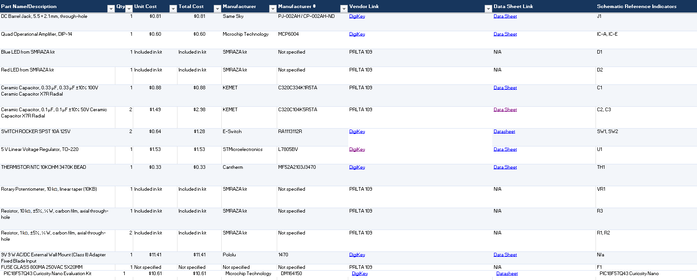

## Overview
My BOM includes all the main components needed for my heart rate monitor PCB, including the 9V power supply, barrel jack, fuse, and L7805 voltage regulator to provide a stable 5V output. It also includes the PIC18F57Q43 Curiosity Nano board, an MCP6004 op-amp, a thermistor, resistors, capacitors, LEDs, and a pushbutton for the sensing and indicator circuits. Overall, these components provide the power, signal processing, and temperature indication needed for my design.

## Bill of Materials Table

*Table #1*

| **Part Name/Description** | **Qty** | **Unit Cost** | **Total Cost** | **Manufacture** | **Manufacturer #** | **Vendor Link** |**Datasheet Link** | **Schematic Reference Designators** |
|:--------------------|:----|:---------------|:-----|:--------|:-----|:-----|:----|:-----|
DC Barrel Jack, 5.5 × 2.1 mm, through-hole | 1 | $0.81 | $ 0.81 | Same Sky | PJ-002AH / CP-002AH-ND | [DigiKey](https://sc-b.digikeyassets.com/en/products/detail/same-sky-formerly-cui-devices/PJ-002AH/408446?utm_source) | [datasheet link](https://www.sameskydevices.com/product/resource/pj-002ah.pdf) | Tbd if needed |
Quad Operational Amplifier, SOIC-14 | 1 | $0.58 | $0.58 | Texas Instruments | LM324W | [DigiKey](https://www.digikey.com/en/products/detail/texas-instruments/LM324N/277627) | [datasheet link](https://www.ti.com/lit/ds/symlink/lm224.pdf?HQS=dis-dk-null-digikeymode-dsf-pf-null-wwe&ts=1793124509824)  | IC-A, IC-E
Blue LED from SMRAZA kit | 1 | Included in kit | Included in kit | SMRAZA kit | Not Specified | PRLTA 109 | N/a | D1
Red LED from SMRAZA kit | 1 | Included in kit | Included in kit | SMRAZA kit | Not Specified | PRLTA 109 | N/a | D2
Ceramic Capacitor, 0.33 µF, 0.33 µF ±10% 100V Ceramic Capacitor X7R Radial | 1 | $0.88 | $0.88 | KEMET | C0805F104K5RACTU | [DigiKey](https://www.digikey.com/en/products/detail/kemet/C320C334K1R5TA/12701336) | [datasheet link](https://yageogroup.com/content/datasheet/asset/file/KEM_C1050_GOLDMAX_X7R)  | C1
0.1 µF Ceramic Capacitor, +/-10%, X7R, 50V, 0805 package |10 | 0.2750 | $2.75 | KEMET | C0805F104K5RACTU | [DigiKey](https://www.digikey.com/en/products/detail/kemet/C320C104K5R5TA/818040) |  [datasheet link](https://yageogroup.com/content/datasheet/asset/file/KEM_C1050_GOLDMAX_X7R) | C2, C3
SWITCH ROCKER SPST 10A 125V | 2 | $0.64 | $1.28 | E-Switch | RA1113112R | [DigiKey](https://www.digikey.com/en/products/detail/e-switch/RA1113112R/3778055) |[datasheet link](https://configured-product-images.s3.amazonaws.com/Datasheets/RA1.pdf) | SW1, SW2
5 V Linear Voltage Regulator, TO-220 | 1 | $1.53 | $1.53 | STMicroelectronics | L7805BV | [DigiKey](https://www.digikey.com/en/products/detail/stmicroelectronics/L7805ABV-DG/3945936) |  [datasheet link](https://www.st.com/content/ccc/resource/technical/document/datasheet/41/4f/b3/b0/12/d4/47/88/CD00000444.pdf/files/CD00000444.pdf/jcr:content/translations/en.CD00000444.pdf) | LM7805_CM
THERMISTOR NTC 10KOHM 3470K BEAD | 1 | $0.33 | $0.33 | Cantherm | MF52A2103J3470 | [DigiKey](https://www.digikey.com/en/products/detail/cantherm/MF52A2103J3470/1191033) |  [datasheet link](https://www.cantherm.com/wp-content/uploads/2017/05/cantherm_mf52_1.pdf) | TH1
Rotary Potentiometer, 10 kΩ, linear taper (10KB) | 1 | Included in kit | Included in kit | SMRAZA kit | Not Specified | PRLTA 109 | N/a | Potentiometer-CM1
Resistor, 10 kΩ, ±5%, ¼ W, carbon film, axial through-hole | 1 | Included in kit | Included in kit | SMRAZA kit | Not Specified | PRLTA 109 | N/a | R3
Resistor, 1 kΩ, ±5%, ¼ W, carbon film, axial through-hole | 1 | Included in kit | Included in kit | SMRAZA kit | Not Specified | PRLTA 109 | N/a | R1, R2
9V 9 W AC/DC External Wall Mount (Class II) Adapter Fixed Blade Input | 1 | $11.41 | $11.41 | Pololu | 1470 | [DigiKey](https://www.digikey.com/en/products/detail/pololu/1470/19200211) |  [datasheet link](https://www.pololu.com/product-info-merged/1470) | N/a
PIC18F57Q43 Curiosity Nano Evaluation Kit | 1 | $10.61 | $10.61 | Microchip Technology | DM164150 | [DigiKey](https://www.digikey.com/en/products/detail/microchip-technology/DM164150/11586705) |  [datasheet link](https://www.microchip.com/) | PIC18F57Q43 Curiosity Nano
FUSE GLASS 800MA 250VAC 5X20MM | 1 | Not Specified | Not Specified | Not Specified | Not Specified | PRLTA 109 | N/a | F1

## Bill of Materials Excel Image

**Figure 2:** Excel Image

