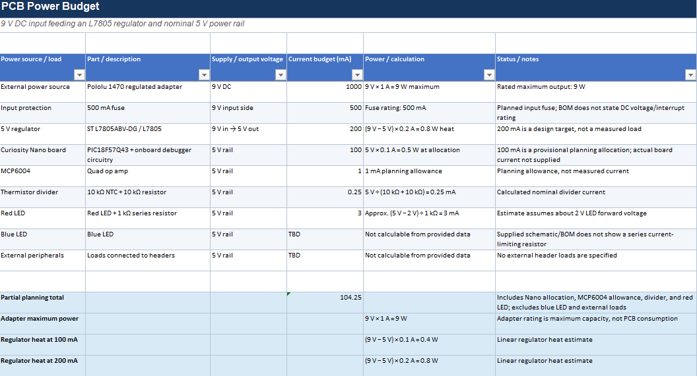

## Overview
My power budget estimates the total current required for my heart rate monitor PCB, including the PIC18F57Q43 Curiosity Nano board, the MCP6004 op-amp, the thermistor circuit, and the red LED. The current consumption is approximately 104.25 mA based on the current estimates, but this is a preliminary total because the blue LED and any external loads have not yet been included. It also helps verify that the 9V input and L7805 voltage regulator can provide the required 5V power while accounting for the regulator’s heat dissipation.

## Conclusions
* The 9 V input connects to the L7805 input; components on its output use the regulated 5 V rail.
* The Curiosity Nano board's total current includes the MCU and onboard debugger circuitry.
* The blue LED current cannot be calculated from the supplied schematic/BOM because a series resistor is not shown.
* The total load depends on the actual Nano board current and any peripherals connected to the headers.
* The L7805 dissipates the input/output voltage difference as heat; thermal behavior depends on mounting and PCB conditions.
* The fuse is listed as 500 mA; its DC voltage and interrupt ratings are not specified in the provided BOM. 

## Resouces

The power budget as a PDF download is available [*here*](PowerBudgetWebsiteUpload.pdf), and a Microsoft Excel Sheet [*here*](SMRAZA_PCB_Power_Budget_Website_Upload.xlsx).
